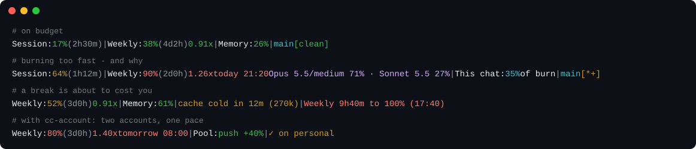

# cc-pace

Claude Code statusline that answers one question: **am I burning my usage too fast?**

- **The easiest to set up:** one line in `settings.json`. No API key, no login, no config file.
- **Zero tokens burnt:** it never calls a model or an API. Every number comes from the data Claude
  Code already hands the statusline.
- **Zero dependencies:** plain Node, with a 30 ms startup budget on top of Node's own that CI enforces.



Read the second line as: the weekly window is 90% used with 2 days left, being spent **1.26x faster
than the budget allows**, so at this rate it runs dry **today at 21:20** - well before it resets.
The cause follows: this session's spend went 71% to Opus 5.5 and 27% to Sonnet 5.5 subagents.

## Why

Claude Code shows you a percentage. A percentage alone can't tell you whether 71% is fine or
alarming - that depends entirely on how much of the window has elapsed. cc-pace divides the two.

## No API calls, no tokens, ever

Some usage trackers poll an API or ask a model, and that spends the very quota they are watching.
cc-pace does neither. Since Claude Code 2.1.80 the statusline payload already contains
`rate_limits`; cc-pace reads it from stdin and does arithmetic. It makes **zero network requests**,
consumes **zero tokens**, and cannot be rate limited. Run twenty sessions side by side if you like.

What it keeps on disk, beside the config file: `burn-history.json`, a short history of readings the
recent-burn warning needs; `sessions/`, one small file per open session for the session share in `pool`;
and `models/`, where it is up to in each session's transcript for the model mix. Drop `burn` and
`pool` from `segments` and set `modelMix` to `false`, and nothing is written. It reads the session
transcripts Claude Code already keeps, only what was added since the last render, and never sends
them anywhere.

## Install

The package is published as **`claude-code-pace`**; the command it installs is **`cc-pace`**.

```jsonc
// ~/.claude/settings.json
{
  "statusLine": { "type": "command", "command": "npx -y claude-code-pace", "refreshInterval": 60 }
}
```

`cc-pace --setup` prints that snippet. For a faster cold start, install it once and drop the `npx`:

```bash
npm install -g claude-code-pace
```

```jsonc
{ "statusLine": { "type": "command", "command": "cc-pace", "refreshInterval": 60 } }
```

`refreshInterval` redraws the line every minute while the session is idle. Without it the line
only changes when something happens, so the cache warning and the countdowns go stale during a break.

Restart Claude Code.

## The pace ratio

```
ratio = used% / elapsed%
```

A rate-limit window starts exactly its own length before it resets, so `elapsed%` is known without
any history: a 7-day window resetting in 2 days is 71.4% elapsed. Spending 71% of the budget by
then is a ratio of `0.99` - dead on target.

| Ratio | Colour | Meaning |
| --- | --- | --- |
| `< 0.95` | green | under budget; the ETA is hidden because the window never runs dry |
| `0.95 - 1.10` | yellow | on the line |
| `> 1.10` | red | the window depletes before it resets |

The ETA is the projected moment usage reaches 100% at the current average rate. When the ratio is
red, the model and its settings follow it - `1.26x Fri 21:20 Opus 5/high +think` - because the
model is usually the cause and the thing to change. When subagents spend on other models, each
model's share of the session's recent spend follows too: `Opus 5.5/medium 71% · Sonnet 5.5 27%`.
The shares come from the session's transcripts, priced per model, so they match what `/usage`
reports.

An average over the whole window cannot see a burst: a quiet week hides a hard hour. The `burn`
segment measures the rate over roughly the last hour and speaks only when that rate hits 100% before
the reset - `Weekly 1h7m to 100% (22:13)`. How it guards against stale readings from idle sessions:
[`docs/pace-accuracy.md`](docs/pace-accuracy.md).

## Segments

| Segment | Source |
| --- | --- |
| `Session` | `rate_limits.five_hour` - 5-hour rolling window |
| `Weekly` | `rate_limits.seven_day` - 7-day window, carries the pace ratio by default |
| `Opus` / `Sonnet` / `Fable` | a model's own weekly window, such as `seven_day_fable`, when your plan reports it. Hidden unless `showModelWindows` is on; any model added later is labelled and paced the same way |
| `Pool` | `Pool: 35% ↓24% stop Sat 05:10 +26h`. First, this session's share of what all open sessions spent in the last hour, shown once a second session is burning. Then, with account rotation, whether the accounts together last at your working pace - green `↑40%` to push, red `↓24%` to slow down, with when they run dry and for how many hours - see [With cc-account](#with-cc-account) |
| `Cache` | `Cache: 42% cold in 12m (270k)`. First, how full this conversation is - what the prompt cache holds and `/compact` clears; yellow from 70%, red from 85%. Each session has its own, so the figures of several sessions do not add up to anything. Then `cold in 12m (270k)`, or `cold, next turn re-sends 270k` once expired: a conversation of at least 100k tokens whose prompt cache is within 15 minutes of expiring. Past expiry, the next turn re-sends the whole conversation as cache writes, which can cost more than an hour of work; `/compact` before a break avoids it. From `prompt_cache` in the payload (Claude Code 2.1.251+) |
| burn | the recent-rate warning above; empty while the recent rate is safe |
| rotation | account-switch status, when `rotation` is configured - see below |
| git | branch plus `*` modified, `+` untracked, `↓n` behind, `↑n` ahead |
| chain | the output of another statusline, when `chain` is configured - see [Keep your current statusline](#keep-your-current-statusline) |
| `! config` | appears when the config file cannot be read, so defaults are in force |

Buckets Claude Code starts sending that cc-pace has never heard of are rendered anyway, with a
humanised label, rather than silently dropped.

## Options

| Flag | Effect |
| --- | --- |
| `--demo` | render a bundled sample payload; no stdin needed |
| `--dump` | pretty-print the raw statusline JSON and exit |
| `--json` | print the computed metrics as JSON instead of a line |
| `--no-color` | disable ANSI colour (`NO_COLOR` is honoured too) |
| `--setup` | print the settings.json snippet |
| `--config` | print the resolved config and where it was loaded from |

`--dump` is the fastest way to see what Claude Code actually hands a statusline command.

`--json` exposes numbers the line has no room for, including `safe_rate_percent_per_day` - how much
of the budget you can spend per day from now on and still land exactly at the reset.

## Configuration

Optional. Zero-config is the supported default. `~/.config/cc-pace/config.json`:

```json
{
  "segments": ["limits", "pool", "cache", "burn", "rotation", "git", "chain"],
  "separator": " | ",
  "hideCalm": false,
  "showModelWindows": false,
  "modelMix": true,
  "paceOn": ["seven_day"],
  "eta": "when-early",
  "minElapsedPct": 5,
  "warn": 0.95,
  "danger": 1.1,
  "usedWarn": 50,
  "usedDanger": 80,
  "memoryWarn": 70,
  "memoryDanger": 85,
  "cacheWarnTokens": 100000,
  "cacheWarnSecs": 900,
  "ascii": false
}
```

- `segments` - order and contents of the line. `"limits"` expands to every bucket present.
  Aliases: `session`, `weekly`, and any model's name for its own window (`fable`, `opus`). The
  older names `share` and `memory` still work and draw `pool` and `cache`.
- `showModelWindows` - add every model's own window to `"limits"`. Off by default: the account-wide
  windows are the ones that stop work. Naming one model in `segments` shows only that one.
- `hideCalm` - show a window only when it is at or over pace or past `usedWarn`, and the cache
  percentage only past `memoryWarn`. The line then carries only what needs attention.
- `paceOn` - which buckets get the ratio and ETA. Add `"five_hour"` to pace the session too.
- `eta` - `when-early` (default), `always`, or `never`.
- `minElapsedPct` - how much of a window must have elapsed, or been used, before its ratio is
  shown. Below both the denominator is near zero and the number is noise; a heavy early burn
  (12% used 3% into the week) shows at once.
- `ascii` - use `v`/`^` instead of `↓`/`↑` for fonts without the arrows.

Environment overrides: `CC_PACE_SEGMENTS`, `CC_PACE_SEPARATOR`, `CC_PACE_ETA`, `CC_PACE_ASCII`,
`CC_PACE_CONFIG`, `NO_COLOR`.

### Keep your current statusline

Claude Code runs one statusline command. To keep the one you had, give it to cc-pace as `chain`:

```json
{ "chain": "npx -y other-statusline", "chainTimeoutMs": 1000 }
```

cc-pace hands it the same payload, runs it while doing its own work, and adds its output where
`"chain"` sits in `segments` - last by default - each line of it joined like a segment, colours
kept. If it fails, prints nothing or takes longer than `chainTimeoutMs`, cc-pace's own line shows
alone. A chained command that leads back to cc-pace is not run again.

## With cc-account

cc-pace works alone: pace, burn, cache and the session share need nothing else.

Installed with [cc-account](https://github.com/poisons77/cc-account), it also switches accounts by
itself. cc-pace watches usage and decides where to go; cc-account switches and keeps logins alive.
The statusline payload carries no account identity, so cc-pace cannot name the account it
describes - cc-account publishes which one is live and when each login stops refreshing, and
cc-pace never switches into one about to log out.

With `work` and `personal` in rotation, the line also says whether the two together last, and what
to do about it:

```
Weekly: 80% (3d0h) 1.40x | Pool: ↑40%
Weekly: 90% (4d0h) 2.10x | Pool: ↓24% stop Sat 05:10 +26h
```

The pool forecast follows how you work, not the clock. It measures what the pool burns per hour of
work, the last few hours counting most, and learns which hours of the day you work from Claude
Code's own prompt history (timestamps only), so nights you sleep are not projected as burn. It
then plays that forward - always drawing on the account whose reset comes first, since what it
holds at its reset is lost - and finds the most you can burn per working hour and still last.
- green `↑40%` - you can push: the pool lasts even 40% faster than your current pace.
- red `↓24%` - slow down by 24% to last. `stop Sat 05:10 +26h` is when every account runs dry at
  your current pace, and how many hours until the first one refills.

The pool assumes the accounts are on the same plan.

Install it alongside cc-pace:

```bash
npm install -g cc-account
```

Or as a Claude Code plugin, which also gives a `/cc-account` command:

```
/plugin marketplace add poisons77/cc-account
/plugin install cc-account@cc-account
```

Save a snapshot once per account (`cc-account save <name>`), then connect the two at one of two
depths, cheap and full.

**One command at a threshold.** `onThreshold` runs any shell command once per window when a bucket
crosses a percentage. cc-pace never learns what the command does.

```json
{
  "onThreshold": { "bucket": "five_hour", "at": 95, "run": "cc-account rotate" }
}
```

`cc-account rotate` moves to whichever account was switched away from longest ago. No account
names in the config, no state beyond a latch that clears when the window resets.

**The rotation engine.** Watches several windows, chooses a target on what it knows of each
account, waits out the settle window after a move, and reports the outcome in the line itself:

```json
{
  "rotation": {
    "accounts": ["work", "personal"],
    "buckets": { "five_hour": 95, "seven_day": { "at": 95, "lateAt": 99, "lateWithinSecs": 129600 } },
    "command": "cc-account"
  }
}
```

```
Session: 95% (2h18m) | Weekly: 67% (4d20h) | → switching to personal
Session: 2% (5h0m)   | Weekly: 61% (4d2h)  | ✓ on personal
```

Name `primary` and `fallback` instead of `accounts` for a reserve account you return to rather than
peers you rotate between.

This tier needs cc-account specifically, because it reads the identity cc-account publishes to
`~/.claude-accounts/rotation-state.json` on every switch. Any tool writing that file would do; no
other tool does.

Thresholds per window, what is known about an account you are not on, why nothing is decided for
two minutes after a switch, and the failure reporting: [`docs/rotation.md`](docs/rotation.md).

## Performance

The statusline re-renders on activity, so startup is the only cost that matters. Node's own boot
time is a floor no Node CLI beats, and it swings by tens of milliseconds across platforms, so the
number worth quoting is the **overhead cc-pace adds on top of that floor**.

The budget is **30 ms**, and CI fails the build past it. Measure it on your own machine:

```bash
npm run bench
```

One Windows laptop reports:

```
runs          20
node boot     36.5 ms  (floor, not ours)
cc-pace total 52.6 ms
our overhead  16.1 ms  (budget 30 ms)
```

Zero runtime dependencies, and git state comes from a single `git status --porcelain=v2 --branch`
rather than four separate invocations.

## Robustness

A statusline that throws is worse than one that is briefly empty. Malformed JSON, a missing
`rate_limits`, a broken config file, a directory that is not a git repository - each degrades to a
shorter line, never to a stack trace.

## Compatibility

Requires Claude Code >= 2.1.80 for `rate_limits` in the statusline payload, and Node >= 22. On
older Claude Code versions the limit segments are simply absent.

`rate_limits` is an internal payload shape and can change without notice. cc-pace treats every
field as optional for that reason.

## Development

```bash
npm test        # 141 tests, node:test, no dependencies
npm run demo
npm run bench
```

How the pace ratio behaves early in a window, and why a cumulative ratio cannot see a burst:
[`docs/pace-accuracy.md`](docs/pace-accuracy.md).

## Licence

MIT. See [LICENSE](LICENSE).

Not affiliated with Anthropic. "Claude" and "Claude Code" are trademarks of their respective owner.
